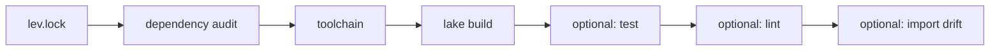

# lev

A [uv](https://github.com/astral-sh/uv)-inspired project environment manager
for Lean: toolchains, dependencies, caches, and repeatable workspaces behind
one command.

lev started from a practical annoyance. Returning to a Lean project should be
uneventful. A cold build is still a cold build, but a second checkout should
not forget everything the first one downloaded, resolved, and built.
lev reuses matching toolchains, exact Git dependencies, locked environments,
and compatible Lake artifacts across projects.

**[Read the full documentation](https://robertboy18.github.io/lev/)** for
toolchains, version matrices, workspaces, scripts, remote caches, and CI.

The manual is split by workflow, so you can go directly to the part you need:

- [Getting started](https://robertboy18.github.io/lev/getting-started.html):
  install lev, adopt an existing Lake project, and learn the daily commands.
- [Environments and cache](https://robertboy18.github.io/lev/environments.html):
  understand environment identity, locks, shared artifacts, signed remote
  snapshots, and version matrices.
- [Imports and graphs](https://robertboy18.github.io/lev/imports.html):
  preview safe import minimization, read explanations, run it across a
  workspace, and inspect the FLT case study.
- [Profiling](https://robertboy18.github.io/lev/profiling.html): distinguish
  one-run lev timings, repeated process samples, and Lean's native elaborator
  profiler, with plots and JSON output.
- [Automation](https://robertboy18.github.io/lev/automation.html): compose
  verification, upgrades, workspace operations, bundles, watch loops, tasks,
  scripts, and CI.
- [Command reference](https://robertboy18.github.io/lev/reference.html): scan
  the complete command map, output schemas, and exit behavior.

## Installation

You do not need to clone this repository.

First, check for Cargo:

```console
cargo --version
```

If Cargo is missing, install Rust with [rustup](https://rustup.rs/).

macOS or Linux:

```console
curl --proto '=https' --tlsv1.2 -sSf https://sh.rustup.rs | sh
source "$HOME/.cargo/env"
```

Windows users can run
[`rustup-init.exe`](https://win.rustup.rs/). On macOS, run
`xcode-select --install` if compilation reports a missing compiler or linker.

Install lev directly from GitHub:

```console
cargo install --git https://github.com/Robertboy18/lev --locked lev-cli
lev --version
lev doctor
```

The Cargo package is `lev-cli`; the installed executable is `lev`.

To remove lev later, preview the exact executable and removal method first:

```console
lev self uninstall --dry-run
lev self uninstall
```

Cargo installations are removed through `cargo uninstall lev-cli` so Cargo's
install record stays correct. lev keeps its cache and toolchain data.

## Quick Start

Use lev in an existing Lake project:

```console
cd my-lean-project
lev sync
lev build
```

Or create a project:

```console
lev init hello --lean stable
cd hello
lev build
lev run lean --version
```

Nothing needs to be activated.

## Why Use It?

- **Fast returns to existing environments.** Reuse compatible Lake artifacts,
  exact Git revisions, and installed toolchains across checkouts.
- **Several Lean versions without one shared mess.** Keep separate locks,
  manifests, build trees, and cache namespaces, then return to any of them.
- **Standard Lean projects.** `lean-toolchain`, the Lakefile, and
  `lake-manifest.json` remain authoritative. There is no private lev package
  format.
- **Frozen and offline runs.** Verify the toolchain, platform, manifest, lock,
  and dependency checkouts before a build starts.
- **Safer dependency edits.** Declarative Lakefile changes roll back if
  resolution does not complete.
- **Less duplicated storage.** Share immutable Git objects and compatible
  artifacts while keeping mutable project workspaces isolated.
- **Better cluster behavior.** `lev --local build` moves write-heavy project
  and `.lake` state into the cache, which can live on node-local scratch.
- **Consistent benchmark environments.** Keep the Lean side of LLM and
  theorem-proving evaluations tied to a specific toolchain, manifest, lock,
  and cache namespace.
- **Useful beyond one build.** Matrices, monorepo workspaces, standalone Lean
  scripts, package tools, audits, SBOM export, and signed remote artifacts use
  the same environment model.

## Elan, Lake, And lev

lev coordinates the tools Lean already has:

| Tool | Owns |
| --- | --- |
| [elan](https://github.com/leanprover/elan) | Installing and selecting Lean toolchains |
| [Lake](https://github.com/leanprover/lean4/blob/master/src/lake/README.md) | Resolving packages and executing the build graph |
| lev | Locks, shared storage, isolated environments, cache policy, and repeatable execution |

lev can use its verified toolchain store or fall back to elan. Lake still
decides what a build means and whether an artifact is valid.

## Fast Cache Reuse

In one measured fresh-checkout comparison, another checkout had already
populated the compatible artifact cache:

| Fresh checkout command | Elapsed |
| --- | ---: |
| Default Lake with an empty local artifact cache | 9.66 s |
| `lev build` with the compatible cache present | 0.26 s |
| Lake with the same shared cache configured manually | 0.25 s |

The warm lev run was about **37x faster than the cold run**. Manually
configured warm Lake was equally fast, as it should be: Lake is the artifact
cache engine. lev makes the cache path, toolchain namespace, locks, Git reuse,
verification, and cleanup consistent across projects.

The speedup came from reusing compatible work; lev did not make Lean compile
new code 37x faster. See the
[documentation](https://robertboy18.github.io/lev/environments.html#cache) for the measurement
conditions and cache boundaries.

## Automatic Import Minimization

Import minimization came from a similar annoyance. A file might use one small
corner of Mathlib, yet finding the right leaf imports by hand means guessing
about syntax, tactics, instances, and elaboration-time dependencies.
lev asks the selected Lake toolchain instead. It uses compiled dependency
metadata to replace broad imports such as `import Mathlib` with the modules the
file actually needs. `lev imports` is a descriptive alias for `lev shake`:

```console
lev imports MyProject.Proof --explain
lev imports MyProject.Proof --apply
```

For example, `MyProject/Primes.lean` might start with one broad public import:

```lean
module

public import Mathlib

public theorem five_is_prime : Nat.Prime 5 := Nat.prime_five
```

Running `lev imports MyProject.Primes --explain` prints every proposed removal
and addition. The reason attached to
`public import Mathlib.Data.Nat.Prime.Defs` identifies `five_is_prime` and its
reference to `Nat.Prime`. The result can also contain private imports for
syntax, tactics, instances, or elaborators. Those are compiler-recorded
dependencies, not source-text guesses, and the exact list can change with the
Mathlib version.
`--apply` writes the complete list, rebuilds the package defaults, and then
rebuilds any explicitly requested module roots. Verification builds bypass
Lake's artifact cache and finish with freshness checks, so a cache hit cannot
hide a missing `.olean`.

Without `--fix` or `--apply`, the command is a dry run and exits with status 1
when it finds changes. Applying snapshots every affected project source,
accepts Lake's suggestions, and verifies both default and requested targets. lev
restores all edited files if either build fails. Stale `.olean` files are built
automatically before analysis unless `--no-build` or `--force` is selected.

Omit the module to analyze the package's default targets. Use `--keep-public`
for deliberate public re-exports and `--keep-prefix` when a broader convenience
module is preferable to the exact leaf imports. The selected Lake must provide
its native `shake` command and the analyzed files must use its module system.

For a reusable library, start with the conservative whole-project form:

```console
lev imports --keep-public --keep-implied --explain
lev imports --keep-public --keep-implied --apply
```

If an import is needed only to open a namespace or provide another
elaboration-time effect that Lake cannot trace, preserve it explicitly:

```lean
import Mathlib.Some.Module -- shake: keep
```

For a large project, `--isolate` keeps each subset of edits only after it
passes the real build:

```console
lev imports --keep-public --keep-implied --fix --isolate
```

lev first tries the complete rewrite. If that fails, it restores and verifies
the original baseline, then splits the proposed files into smaller groups.
Passing groups remain applied; failing files are restored and reported with
candidate `-- shake: keep` annotations. A partial result exits with status 1,
and a broken baseline leaves every file unchanged.

CI can check drift and audit which sources Lake actually analyzed:

```console
lev imports --check --coverage
lev imports --check --coverage --json
```

Coverage separates project Lean files into analyzed module files, module files
outside the selected roots, and legacy files without a leading `module`
command. JSON uses the versioned `lev.cli.shake/v1` envelope and includes each
proposed, applied, rejected, or restored file.

### Case Study: Imperial College's FLT Project

A one-file example can make import minimization look easier than it is. The
test that mattered was a real library with public re-exports, namespace
effects, and enough files for a bad rewrite to hurt. On July 28, 2026, lev was
tested against the
[Imperial College London FLT project](https://github.com/ImperialCollegeLondon/FLT)
at commit
[`0996e0c`](https://github.com/ImperialCollegeLondon/FLT/commit/0996e0c76ea248a676fba363be3ea8f04bdf3d44).
This was a whole-project default-target run, not a hand-picked example. The
checkout contained 269 Lean files; the `FLT` default target exposed 259
module-system files to Lake's import analysis.

| Measurement | Result |
| --- | ---: |
| Baseline full build | 8,920 jobs in 196.79 s |
| First, fully aggressive preview | 119 files suggested |
| Conservative final diff | 34 files, 9 insertions, 54 deletions |
| Apply and full verification | 8,920 jobs passed in 228.04 s |
| Repeat minimization run | Exit 0, no further changes |

The first number looked excellent: 119 files could apparently lose broad
imports. Then the full build failed in 10 modules. That failure was the useful
part of the experiment. lev restored every source file from its transaction
snapshot, and the next run preserved public imports. The proposal fell to 76
files, but one module still failed. Preserving implied imports as well brought
the proposal to 34:

```console
lev imports --keep-public --keep-implied --explain
lev imports --keep-public --keep-implied --apply
```

One file still depended on two imports for namespace or elaboration context
that was not represented in the compiled declaration dependency graph. Those
imports were made explicit policy:

```lean
import Mathlib.NumberTheory.NumberField.Basic -- shake: keep
import Mathlib.RingTheory.DedekindDomain.Basic -- shake: keep
```

After those annotations, lev rewrote 33 other files automatically and the
complete 8,920-job build passed. Then came the satisfying final check: running
the same minimization command again found nothing else to change. The project
had reached a fixed point.

This progression is why lev does not treat Lake's first suggestion list as
proof of correctness. A public import can be part of a library's downstream
API even when the current file does not reference it directly, and a
namespace-only import may leave no declaration edge to trace. lev applies the
edits transactionally and accepts them only after rebuilding the real project.

The project also found a bug in lev's idea of "verified." Lake's artifact cache
could report success while omitting a changed `.olean`. lev now disables that
cache for import-verification builds and follows each build with a freshness
check. If either check fails, the original sources are restored.

Those timings belong to this checkout and machine. The reusable result is the
workflow: lev produced a smaller verified import surface and reached the same
fixed point when it ran again.

## Measure, Inspect, And Automate

Once the environments worked, the next problem was all the useful shell glue
that accumulates around Lake. Lake still performs the build, test, lint, and
import analysis. lev gives the timing loops, release checklists, watchers,
reports, and source handoffs a command and a stable output contract.

| Need | Typical Lake-only workflow | With lev |
| --- | --- | --- |
| Time one build | `time lake build` | `lev --timings build` separates lev phases from command time |
| Compare repeated builds | Write a timing loop and calculate statistics | `lev profile` handles warmups, samples, summaries, and JSON |
| Inspect module imports | Write a source or compiler-metadata script | `lev graph` emits text, JSON, or Graphviz DOT |
| Run a release gate | Run build, test, and lint separately | `lev verify` adds lock, audit, toolchain, offline, and import checks |
| Review updates | Run `lake update`, then inspect the manifest diff | `lev outdated` and transactional `lev upgrade --dry-run` |
| Check several root projects | Loop over directories and combine failures | `lev workspace shake` keeps member transactions separate |
| Hand off source | Maintain archive exclusions and metadata yourself | `lev bundle` writes a deterministic locked source archive |
| Rebuild on edits | Add an editor or filesystem watcher | `lev watch` reruns a command in the selected environment |

The Lake-only column describes common command-line practice, not a different
build engine. lev eventually invokes the same project-defined Lake commands.

### Timings And Repeated Profiles

Start with `--timings` when a build feels slow. It answers the first
useful question: was the time spent preparing the environment, waiting for a
lock, or inside the delegated command? The phase report goes to stderr:

```console
lev --timings build
lev --timings test
```

If one run is not evidence enough, move to `profile`. It handles warmups and
repeated samples instead of leaving a timing loop in shell history. It defaults
to `lake build`; a command after `--` can replace that default.

```console
lev profile --warmup 1 --repeat 5
lev profile --warmup 1 --repeat 5 -- lake build MyTarget
lev profile --warmup 1 --repeat 5 --json -o profile.json -- lake build
```

The report includes every sample and the minimum, median, mean, and maximum.
Warmups are run but not recorded. A failed command stops the profile and its
exit code is preserved.

### Import Graphs

One import list is easy to read. Fifty of them are where intuition starts to
lose. `graph` reads project source imports directly without crawling generated
Lake build trees. Roots may be module names or Lean files, and may be repeated:

```console
lev graph MyProject.Main
lev graph MyProject.Main MyProject.Tests --external
lev graph MyProject.Main --external --format dot -o imports.dot
dot -Tsvg imports.dot -o imports.svg
lev graph MyProject.Main --format json -o imports.json
```

Text output lists direct and transitive project-import counts. `--external`
adds dependency modules. The `dot` command above is Graphviz, not part of lev.
`graph` exits unsuccessfully when it finds an import cycle.

### One Verification Gate

The most annoying release failure is often the check nobody remembered to run.
`verify` turns that checklist into one ordered gate and stops at the first
failure:



```console
lev verify
lev verify --clean --offline --strict --test --lint --imports
lev verify --json > verify.json
lev verify --offline --test -- MyLibrary
```

The required phases are lock verification, dependency audit, toolchain
availability, and `lake build`. The optional flags add a clean build, strict
portability checks, the Lake test and lint drivers, and `lake shake` drift
detection. Arguments after the options are passed to `lake build`.

### Dependency Upgrades

An upgrade should begin with a plan, not a mysterious manifest diff. Plain
`lake update` remains available through `lev update`; for a reviewable
Reservoir-aware transaction, preview the compatible direct-dependency changes
first:

```console
lev outdated
lev outdated --check
lev outdated --json > outdated.json
lev upgrade --dry-run
lev upgrade PACKAGE --dry-run
lev upgrade PACKAGE
lev upgrade --group algebra --dry-run
lev upgrade --lean "$NEW_TOOLCHAIN" --dry-run
```

`outdated` distinguishes current, outdated, incompatible, unmanaged, and
unavailable dependencies. With `--check`, it exits with status 1 when a
compatible update exists, which makes it suitable for CI.

`upgrade` can target packages, a configured dependency group, or all indexed
direct dependencies. The toolchain form plans compatible package changes with
the Lean change. Changes are committed only after Lake resolves them and lev
verifies the resulting revisions; failures restore the original project files.

### Workspace Import Policy

A five-line shell loop looks tempting in a monorepo until one member fails
halfway through and the edits no longer have a clear owner. With `[workspace]`
members in `lev.toml`, one command can check or minimize imports across
independent Lake roots:

```console
lev workspace shake --check --coverage --keep-going
lev workspace shake --check --json --keep-going > imports.json
lev workspace shake --check --sarif lev-shake.sarif --keep-going
lev workspace shake \
  --keep-public \
  --keep-implied \
  --apply \
  --isolate \
  --keep-going
```

Each member keeps its own toolchain, manifest, lock, and rollback boundary.
JSON and SARIF combine the member results while retaining member-relative
paths.

### Deterministic Bundles

A source handoff usually starts as a quick `tar` command and slowly acquires an
exclusion list. `bundle` makes that policy part of lev instead:

```console
lev lock --check
lev bundle
lev bundle -o project.lev.tar.zst
```

`bundle` requires a current `lev.lock` and records file hashes in
`lev-bundle.json`. It excludes Git state, `.lake`, dependency checkouts, and
generated build trees. It is a portable source archive, not a vendored
dependency or binary bundle. Unchanged inputs produce byte-identical output;
an existing destination is not replaced unless `--force` is present.

### Watch Mode

For the edit loop, `watch` keeps the same selected environment between saves.
It defaults to `lake build`, runs once immediately, then reruns after a
debounced project-file change:

```console
lev watch
lev watch -- lake test
lev watch --debounce-ms 500 --exit-on-failure -- lake build MyTarget
lev watch --no-initial --max-runs 10 -- lake build
```

It ignores lev-managed lock and manifest writes so synchronization does not
trigger another run. `--no-initial` waits for the first edit, and
`--max-runs` makes the loop bounded for automation.

`profile`, `watch`, and `workspace shake` also accept `--lean` to select a
locked environment, `--offline` to refuse network access, and `--no-sync` when
the caller has already prepared the dependencies.

## Version Switching And Matrices

Any release, RC, nightly, channel, or complete selector supported by the
configured toolchain source can be used. Versions are not hardcoded.

```console
lev lock --lean "$PAPER_TOOLCHAIN" --lean "$CURRENT_TOOLCHAIN"
lev build --lean "$PAPER_TOOLCHAIN"
lev build --lean "$CURRENT_TOOLCHAIN"
lev build --lean "$PAPER_TOOLCHAIN"
```

Use a matrix when the same command should run in isolated environments:

```console
lev matrix \
  --lean "$PAPER_TOOLCHAIN" \
  --lean "$CURRENT_TOOLCHAIN" \
  --keep-going \
  -- lake build --wfail
```

lev reports compatibility; it does not rewrite proofs for an incompatible
Lean release.

## Reproducible And Local Runs

```console
lev lock --check
lev sync --frozen
lev build --offline
lev audit
```

For a project on EFS, NFS, or another shared filesystem, point the cache at
local scratch:

```console
LEV_CACHE_DIR="$LOCAL_SCRATCH/lev-cache" lev --local build
```

Inspect storage before deleting anything:

```console
lev cache status
lev cache verify --full
lev cache gc --max-age-days 14
lev cache gc --max-age-days 14 --apply
```

Garbage collection is a dry run until `--apply` is present.

## More

```console
lev add PACKAGE --scope OWNER
lev run lake env my-tool
lev shake MyProject.Proof --fix
lev graph MyProject.Proof --external
lev verify --offline --imports
lev bundle -o project.lev.tar.zst
lev watch -- lake build
lev script run Example.lean
lev workspace shake --check --sarif lev-shake.sarif --keep-going
lev export --format cyclonedx -o lev-sbom.json
```

Run `lev --help` for the complete command list. The
[documentation](https://robertboy18.github.io/lev/) contains examples and
explains current limitations.

The repository includes a
[lev agent skill](https://github.com/robertboy18/lev/blob/main/.agents/skills/lev/SKILL.md)
for Codex, Claude Code, and other coding agents. It covers environment setup,
builds, dependencies, import minimization, Lean and Mathlib source quality,
and worktree safety. For agents that do not discover skills automatically, use
this prompt:

```text
Read .agents/skills/lev/SKILL.md before working on this Lean project.
```

## Contributing

lev is a new project, and contributions are welcome. The interface is open for
discussion, especially around package workflows, benchmark reproducibility, and
community conventions. If a platform, Lean project, proxy, filesystem, or
toolchain workflow behaves badly, please open an issue or send a pull request.

See [CONTRIBUTING.md](CONTRIBUTING.md) for development commands and
[SECURITY.md](SECURITY.md) for trust boundaries.

## License

Made by Robert Joseph George.

lev is available under the [MIT License](LICENSE-MIT).
